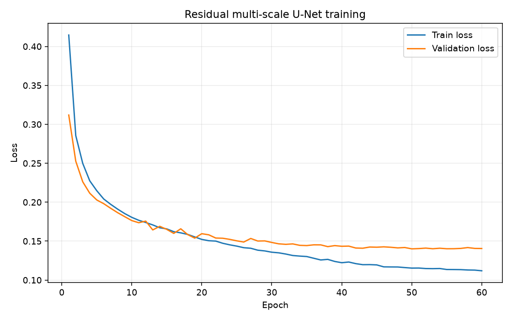
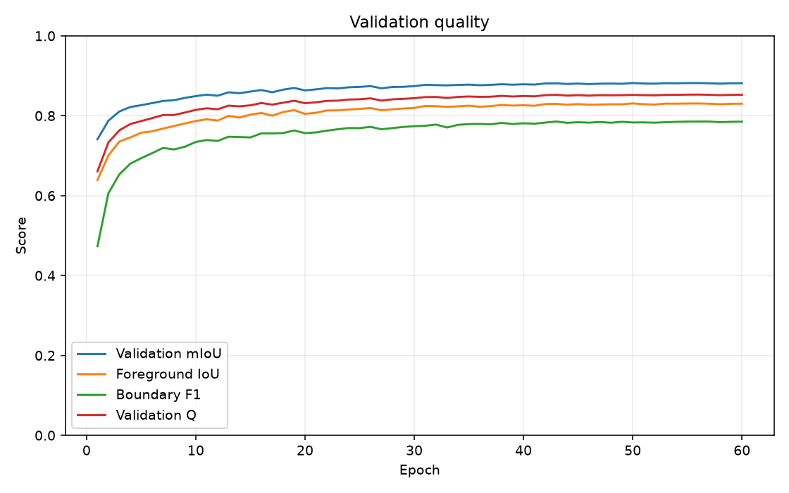
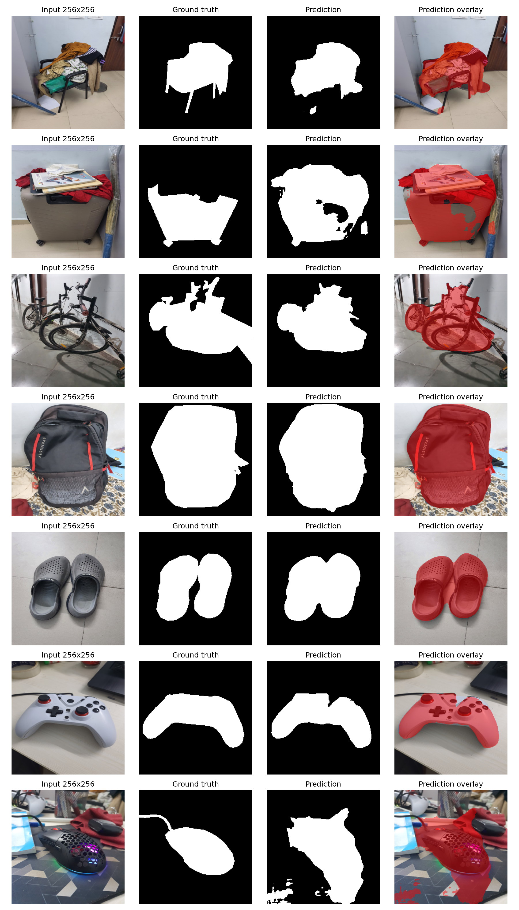
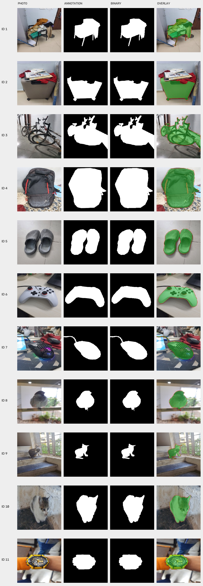

# CSL7360 — Computer Vision Assignment 2
## Cost-Efficient Salient Object Segmentation

**Student:** Prasangeet Dongre  
**Roll Number:** B23CH1033  
**Course:** CSL7360 — Computer Vision

This repository contains a lightweight binary salient-object segmentation system built with PyTorch and evaluated under a constrained CPU-inference budget. The experiments use DUTS for training, validation, and the official test benchmark, followed by a separate evaluation on eleven manually captured photographs.

The project studies the trade-off between segmentation quality, boundary accuracy, inference latency, and serialized model size. It also documents where the model generalizes well and where it fails on cluttered, occluded, or visually ambiguous scenes.

## Table of contents

1. [Executive summary](#1-executive-summary)
2. [Problem formulation](#2-problem-formulation)
3. [Dataset and experimental split](#3-dataset-and-experimental-split)
4. [Network architecture](#4-network-architecture)
5. [Training methodology](#5-training-methodology)
6. [Evaluation protocol and metrics](#6-evaluation-protocol-and-metrics)
7. [Official DUTS-TE results](#7-official-duts-te-results)
8. [Supplementary evaluation on personal photographs](#8-supplementary-evaluation-on-personal-photographs)
9. [Interpreting the experiments together](#9-interpreting-the-experiments-together)
10. [Reproducibility](#10-reproducibility)
11. [Repository layout](#11-repository-layout)
12. [Limitations and next experiments](#12-limitations-and-next-experiments)
13. [Final conclusion](#13-final-conclusion)

---

## 1. Executive summary

The selected checkpoint is a **three-level residual U-Net with dilated multi-scale context and deep supervision**. It receives 128 × 128 RGB tensors during inference. For the assignment-compliant DUTS-TE evaluation, the input photograph is first represented at 256 × 256, reduced to the model's 128 × 128 working resolution inside the timed function, and the output logits are interpolated back to 256 × 256 before thresholding.

### Official DUTS-TE result

| Measure | Result |
|---|---:|
| Test images | 5,019 |
| Metric / prediction resolution | 256 × 256 |
| CNN working resolution | 128 × 128 |
| Foreground IoU | 0.587513 |
| Background IoU | 0.910646 |
| **Aggregate mIoU** | **0.749080** |
| Mean per-image Boundary F1 | 0.519177 |
| Quality score Q | 0.680109 |
| CPU time per image, T_CPU | **17.3210 ms** |
| Checkpoint size, S_disk | **767,807 bytes (0.7322 MiB)** |
| **Compute Efficiency Score (CES)** | **0.620539** |

The measured CPU time is below the assignment limit of 50 ms per image. The checkpoint is also below the 4 MiB storage budget. The official score is therefore non-zero under the assignment's CES formula.

### Personal-photo result

The supplementary evaluation uses all eleven paired personal photographs and their manually drawn binary masks.

| Measure | Result |
|---|---:|
| Number of photographs | 11 |
| Resolution | 256 × 256 |
| Foreground IoU | 0.777372 |
| Background IoU | 0.919461 |
| **Aggregate mIoU** | **0.848417** |
| Mean per-image mIoU | 0.853196 |
| Mean per-image Boundary F1 | 0.597759 |
| Quality score Q | 0.773219 |
| Mean CPU time over 220 timed predictions | 17.1447 ms |
| Median CPU time over 220 timed predictions | 16.6661 ms |
| Checkpoint size | 767,807 bytes |
| CES | Not calculated for this custom set |

The personal-photo result is a small supplementary generalization study. It is not a replacement for the 5,019-image DUTS-TE benchmark and is not used to calculate the official CES.

---

## 2. Problem formulation

The task is binary salient-object segmentation. For an input RGB photograph, the network predicts a foreground probability for each pixel. Thresholding the probabilities at 0.5 produces a binary mask:

- Foreground / salient object: 1 (saved as 255 in PNG output).
- Background: 0 (saved as 0 in PNG output).

The model is intentionally compact. The experiment does not use pretrained segmentation weights or a pretrained backbone. The final checkpoint is trained on DUTS-TR and selected using a validation subset of DUTS-TR.

The principal design question is not only whether the network can segment an object accurately, but whether that quality can be achieved while respecting the CPU-time and model-size budgets.

---

## 3. Dataset and experimental split

### 3.1 DUTS

The dataset layout expected by the code is:

```text
data/
├── DUTS-TR/
│   ├── DUTS-TR-Image/
│   └── DUTS-TR-Mask/
└── DUTS-TE/
    ├── DUTS-TE-Image/
    └── DUTS-TE-Mask/
```

The experiment uses the standard DUTS split sizes:

| Split | Images | Purpose |
|---|---:|---|
| DUTS-TR | 10,553 | Training and validation source |
| DUTS-TR training subset | 9,498 | Gradient updates |
| DUTS-TR validation subset | 1,055 | Monitoring and checkpoint selection |
| DUTS-TE | 5,019 | Final benchmark evaluation |

The validation subset is 10% of DUTS-TR. The code creates a deterministic, foreground-area-stratified split: images are ordered by the foreground proportion in their masks, divided into quantile-like strata, and sampled with seed 42. The split indices and filenames are saved with the final experiment so that the same validation images can be recovered.

DUTS-TE is not loaded by the training loop and is not used for gradient updates or the saved validation checkpoint-selection calculation.

> **Benchmark-integrity note:** During the broader iterative development of this project, DUTS-TE results were inspected during comparisons between candidate approaches. Therefore, although DUTS-TE was not used for training or gradient-based checkpoint selection, it should not be described as a completely untouched blind test set. The reported score is the final run under the documented evaluation protocol, with this development-history limitation disclosed.

### 3.2 Image and mask preprocessing

Training and validation use the `DUTSDataset` loader, which resizes each original photograph directly to 128 × 128 with OpenCV `INTER_AREA` and each mask directly to 128 × 128 with `INTER_NEAREST`. A mask pixel is foreground when its grayscale value is at least 128; otherwise it is background. Training tensors are converted from BGR to RGB, represented as floating-point values, and normalized to [0, 1].

The official DUTS-TE evaluator follows a separate 256 × 256 path. It first resizes each source photograph and ground-truth mask to 256 × 256 outside the timed region. Inside the timed function, the photograph is downsampled to the model's 128 × 128 working resolution; the predicted logits are then upsampled and thresholded at 256 × 256. Official DUTS-TE metrics are computed at 256 × 256, whereas training-loop validation diagnostics are computed at 128 × 128. Original aspect ratios are not preserved by these fixed square resizes.

### 3.3 Training-only augmentation

Augmentation is applied to DUTS-TR training samples, not to validation or test samples. Image and mask receive the same geometric transform:

- Horizontal flip with probability 0.5.
- Vertical flip with probability 0.10.
- Isotropic scale perturbation sampled from 0.90 to 1.10, with probability 0.5.
- Image-only brightness/intensity perturbation, per-channel gain perturbation, and clipping to the valid 8-bit range.

Masks use nearest-neighbour interpolation during geometric transforms. Newly exposed mask pixels are background. These transformations increase variation in object position, scale, orientation, brightness, and colour without changing the intended image-mask correspondence.

---

## 4. Network architecture

The final network is implemented in `models/segmentation_cnn.py`. It is a three-level residual U-Net with a multi-scale context block at its bottleneck and two auxiliary decoder heads used during training.

### 4.1 Encoder

The encoder uses residual convolution blocks with two 3 × 3 convolutions, batch normalization, ReLU activations, and a projected residual shortcut when the input and output channel counts differ.

| Stage | Output channels | Spatial scale relative to 128 × 128 |
|---|---:|---:|
| Encoder 1 | 16 | 1× |
| Encoder 2 | 24 | 1/2 |
| Encoder 3 | 40 | 1/4 |
| Bottleneck | 56 | 1/8 |

Max pooling performs the downsampling between encoder stages.

### 4.2 Dilated multi-scale context

At the bottleneck, three parallel branches use dilation rates 1, 2, and 4. Each branch first projects the features to 16 channels and then applies a depthwise 3 × 3 convolution at its corresponding dilation. The three branch outputs are concatenated, projected back to 56 channels, and combined with the bottleneck input through a residual addition.

The purpose is to expose the bottleneck to multiple receptive-field scales without introducing a large conventional multi-branch convolution block.

### 4.3 Decoder and deep supervision

The decoder upsamples features and concatenates them with the corresponding encoder skip features:

- 56 + 40 channels are decoded to 40.
- 40 + 24 channels are decoded to 24.
- 24 + 16 channels are decoded to 16.

A 1 × 1 convolution produces the final one-channel logit map. During training, auxiliary prediction heads at the quarter- and half-resolution decoder stages provide deep supervision. During ordinary inference, the network returns only the main logits.

The final model contains **175,971 trainable parameters**. The saved best checkpoint occupies **767,807 bytes**.

---

## 5. Training methodology

The final experiment configuration is stored in `final/unet_128_multiscale_v1/config.json`.

| Hyperparameter | Value |
|---|---:|
| Training epochs completed | 60 |
| Best checkpoint epoch | 56 |
| Input resolution | 128 × 128 |
| Batch size | 8 |
| Gradient accumulation steps | 2 |
| Approximate effective batch size | 16 |
| Initial learning rate | 0.0007 |
| Minimum learning rate | 0.000001 |
| Weight decay | 0.00001 |
| Warm-up epochs | 3 |
| Random seed | 42 |
| Training device recorded in config | CUDA |
| Mixed precision | Enabled |

### 5.1 Loss function

Each supervised output uses a 50:50 combination of binary cross-entropy with logits and soft Dice loss:

```text
L_base = 0.5 * L_BCE + 0.5 * L_Dice
```

The deep-supervision objective combines the main and auxiliary decoder losses:

```text
L = 0.60 * L_main + 0.15 * L_quarter + 0.25 * L_half
```

The weights sum to one. The main output receives the largest contribution, while the auxiliary heads encourage intermediate decoder representations to remain useful for segmentation.

### 5.2 Optimizer and learning-rate schedule

AdamW is used for optimization. Weight decay is applied to multi-dimensional weights, while bias and one-dimensional normalization parameters are placed in a no-weight-decay parameter group.

The learning rate is linearly warmed up for the first three epochs and then decayed using a cosine schedule toward 1e-6. Gradient accumulation combines two micro-batches, and gradient norms are clipped to 1.0. Automatic mixed precision is enabled for CUDA training.

### 5.3 Checkpoint selection

The best checkpoint is selected using validation quality:

```text
Q_val = 0.70 * mIoU_val + 0.30 * BF1_val
```

The best recorded checkpoint occurred at epoch 56 of 60.

| Best validation statistic | Value |
|---|---:|
| Validation loss | 0.140266 |
| Foreground IoU | 0.830645 |
| Background IoU | 0.933085 |
| mIoU | 0.881865 |
| Precision | 0.902012 |
| Recall | 0.913032 |
| Boundary F1 | 0.785402 |
| Validation quality Q | 0.852926 |

> **Resolution qualification:** the training/validation dataset loader uses 128 × 128 tensors, so the values above are the 128-resolution training-loop checkpoint-selection diagnostics. The official DUTS-TE result below is separately computed at 256 × 256 using the assignment evaluation path. These validation and test values should not be treated as a strictly resolution-matched comparison.

Training curves and validation history are retained in the final experiment directory:

- Training and validation loss: `final/unet_128_multiscale_v1/loss_curve.png`
- Validation metrics: `final/unet_128_multiscale_v1/validation_metrics.png`
- Configuration: `final/unet_128_multiscale_v1/config.json`
- Per-epoch history: `final/unet_128_multiscale_v1/history.csv` and `history.json`





---

## 6. Evaluation protocol and metrics

The official evaluation implementation is `src/evaluate.py`. It runs on CPU with one PyTorch thread and one OpenCV thread. The evaluation warms up the model once before timing.

### 6.1 Timed inference path

For each official DUTS-TE sample:

1. Load the source photograph and ground-truth mask before timing.
2. Resize the photograph to 256 × 256 and the mask to 256 × 256. This original-file I/O and resize are outside T_CPU.
3. Start CPU process-time measurement with the 256 × 256 BGR image already in memory.
4. Resize the image to 128 × 128 using `INTER_AREA`.
5. Convert BGR to RGB, normalize to [0, 1], construct the tensor, and run the CNN.
6. Bilinearly upsample the logits to 256 × 256.
7. Apply sigmoid and the 0.5 threshold, then materialize the 256 × 256 binary prediction on CPU.
8. Stop timing.

Thus, T_CPU includes the resize from 256 to 128, colour conversion, normalization, tensor creation, model forward pass, upsampling, sigmoid, thresholding, and output conversion. It excludes checkpoint loading, original file I/O, original-photo resizing to 256 × 256, metric computation, and visualization writing.

The official evaluator measures one timed prediction per DUTS-TE image and averages over all 5,019 images.

### 6.2 Mean intersection over union

The evaluator accumulates one dataset-level confusion matrix:

| | Predicted background | Predicted foreground |
|---|---:|---:|
| **Ground-truth background** | TN | FP |
| **Ground-truth foreground** | FN | TP |

Foreground and background IoU are:

```text
IoU_fg = TP / (TP + FP + FN)
IoU_bg = TN / (TN + FP + FN)
```

The reported dataset-level mean IoU is:

```text
mIoU = (IoU_fg + IoU_bg) / 2
```

This is computed from the aggregate confusion matrix, not by averaging the per-image IoU values.

### 6.3 Boundary F1

A boundary pixel is a foreground pixel having at least one background neighbour in its four-connected neighbourhood. Pixels outside the image are treated as background.

A predicted boundary pixel is matched when a ground-truth boundary pixel exists within a 5 × 5 window (radius 2). The same matching is performed in the reverse direction to obtain boundary precision and recall. Their harmonic mean is Boundary F1. The official dataset score is the mean of the per-image Boundary F1 scores.

Boundary F1 complements mIoU: region overlap can remain high even when object contours are displaced, fragmented, or poorly localized.

### 6.4 Quality score and Compute Efficiency Score

The quality component is:

```text
Q = 0.70 * mIoU + 0.30 * BF1
```

The assignment budgets are 50 ms per image and 4 MiB (4,194,304 bytes) for the saved model file. With T_CPU in milliseconds and S_disk in bytes:

```text
CES = Q * (1 - 0.20 * (T_CPU / 50) - 0.10 * min(1, S_disk / 4194304))
```

CES is set to zero if T_CPU exceeds 50 ms. The size term uses the exact serialized checkpoint file size, without compression.

Sanity check with the official numbers:

```text
Q   = 0.70 * 0.749080 + 0.30 * 0.519177 = 0.680109
CES = 0.680109 * (1 - 0.20 * (17.3210 / 50) - 0.10 * (767807 / 4194304))
    = 0.620539
```

---

## 7. Official DUTS-TE results

The final official result is stored in `final/unet_128_multiscale_v1/results_duts-te_256.json`. An earlier 128 × 128 evaluation is retained separately as `final/unet_128_multiscale_v1/results_duts-te_128_legacy.json` for historical reference; it is not the final reported benchmark result.

| Metric | DUTS-TE result |
|---|---:|
| Images evaluated | 5,019 |
| Foreground IoU | 0.587513 |
| Background IoU | 0.910646 |
| **mIoU** | **0.749080** |
| Boundary F1 | 0.519177 |
| **Quality Q** | **0.680109** |
| Total CPU process time | 86.9341 s |
| **Average T_CPU** | **17.3210 ms/image** |
| **Checkpoint size** | **767,807 bytes** |
| Checkpoint size | 0.7322 MiB |
| **CES** | **0.620539** |

Official aggregate confusion matrix (pixel counts):

| | Predicted background | Predicted foreground |
|---|---:|---:|
| Ground-truth background | 265,717,218 | 14,490,106 |
| Ground-truth foreground | 11,582,327 | 37,135,533 |

### 7.1 Efficiency interpretation

- The average CPU latency is 17.3210 ms, approximately 34.64% of the 50 ms budget. The measured run is about 32.679 ms per image below the limit.
- The checkpoint is 767,807 bytes, approximately 18.30% of the 4 MiB size budget.
- Both hard budget constraints are satisfied, so the efficiency penalty is moderate rather than eliminating the score.
- The network's 128 × 128 internal resolution is an important part of the efficiency design. The returned prediction and official metric masks remain 256 × 256.

### 7.2 Quality interpretation and generalization gap

Background IoU (0.910646) is substantially higher than foreground IoU (0.587513). The model is generally more reliable at rejecting background pixels than at recovering every foreground pixel. The foreground IoU and Boundary F1 indicate that missed object regions and imprecise contours remain important limitations.

The best training-loop validation mIoU was 0.881865 and the official DUTS-TE mIoU was 0.749080. The validation quality was 0.852926, whereas the official test quality was 0.680109. This is a sizeable generalization gap. It suggests that the validation subset was easier or otherwise not fully representative of the test distribution, and that strong validation performance did not translate one-to-one to the test set. The resolution qualification in [Section 5.3](#53-checkpoint-selection) also means the validation and test figures are not a perfectly matched comparison.

---

## 8. Supplementary evaluation on personal photographs

Eleven phone photographs were retained in the captured-photo evaluation. Each has a manually annotated binary target mask. The evaluator includes every matching image–mask pair, including difficult and ambiguous scenes, rather than dropping poor-performing examples. This is a small, manually selected stress test and not a statistically representative benchmark.

### 8.1 Captured scenes

| ID | Target definition | Scene characteristic |
|---|---|---|
| 1 | Chair in a clothes-covered / occluded scene | Heavy overlap and clutter; composite target |
| 2 | Suitcase | Partly covered by nearby objects; dark internal details |
| 3 | Two bicycles as one annotated foreground region | Overlapping structures, spokes, and thin boundaries |
| 4 | Backpack | Cluttered background |
| 5 | Pair of clogs | Two similar foreground objects |
| 6 | Game controller | Relatively distinct object silhouette |
| 7 | Computer mouse | Small object on a textured mousepad / cluttered background |
| 8 | Bird perched on a rail | Small foreground subject against a bright, reflective window |
| 9 | Cat looking through a window | Small foreground region with window bars and a detailed exterior |
| 10 | Kitten | Close-up animal subject against a textured floor and wall |
| 11 | Wristwatch | Small, detailed object on a wrist with a blurred background |

Only the visible target region is foreground in occluded scenes. The labels are based on the manual masks, not on an automatic class annotation. In particular, IDs 1 and 3 use composite scene definitions; their scores should be interpreted according to those target definitions.

### 8.2 Aggregate captured-photo metrics

| Metric | Result |
|---|---:|
| Number of photographs | 11 |
| Resolution | 256 × 256 |
| Foreground IoU | 0.777372 |
| Background IoU | 0.919461 |
| **Aggregate mIoU** | **0.848417** |
| Mean per-image mIoU | 0.853196 |
| Mean per-image Boundary F1 | 0.597759 |
| **Quality Q** | **0.773219** |
| Mean CPU time over 220 timed predictions | 17.1447 ms |
| Median CPU time over 220 timed predictions | 16.6661 ms |
| Checkpoint size | 767,807 bytes |
| CES | Not calculated for this custom set |

The aggregate mIoU is calculated from the combined confusion matrix. Mean per-image mIoU is shown separately because it gives every photograph equal weight. The quality score uses aggregate mIoU and mean per-image Boundary F1: (Q=0.70,mIoU+0.30,BF1). Captured-photo CES is deliberately left unset; the official CES uses the full DUTS-TE timing protocol.

### 8.3 Per-image results

| ID | Target | Foreground IoU | Background IoU | mIoU | Boundary F1 | Mean CPU (ms) |
|---|---|---:|---:|---:|---:|---:|
| 1 | Occluded chair scene | 0.866912 | 0.963910 | 0.915411 | 0.719701 | 16.3948 |
| 2 | Suitcase | 0.468532 | 0.689050 | 0.578791 | 0.297589 | 16.0810 |
| 3 | Two bicycles | 0.747097 | 0.871070 | 0.809083 | 0.445320 | 16.9674 |
| 4 | Backpack | 0.947325 | 0.929285 | 0.938305 | 0.651359 | 19.2489 |
| 5 | Pair of clogs | 0.922388 | 0.966059 | 0.944223 | 0.866655 | 17.0273 |
| 6 | Game controller | 0.924217 | 0.975738 | 0.949977 | 0.794693 | 17.3429 |
| 7 | Computer mouse | 0.503365 | 0.792940 | 0.648153 | 0.165055 | 17.0637 |
| 8 | Bird | 0.930298 | 0.990199 | 0.960249 | 0.867283 | 17.0013 |
| 9 | Cat at window | 0.570051 | 0.965118 | 0.767584 | 0.434663 | 18.3466 |
| 10 | Kitten | 0.895625 | 0.971730 | 0.933678 | 0.644049 | 17.3538 |
| 11 | Wristwatch | 0.896512 | 0.982901 | 0.939706 | 0.688980 | 15.7636 |

### 8.4 Captured-photo timing

The captured evaluator performs one warm-up prediction, then 20 timed predictions for each of the eleven in-memory images: 220 timed predictions in total. The same 256-to-128-to-256 inference function is timed. Image and mask reads, metric calculation, and visualization writing are outside the timed region.

| Timing statistic | Result |
|---|---:|
| Timed predictions | 220 |
| Mean CPU time | 17.1447 ms |
| Median CPU time | 16.6661 ms |
| Standard deviation | 1.5790 ms |
| Minimum | 14.5730 ms |
| Maximum | 22.2957 ms |

These timings are supplementary measurements over eleven selected photographs. They are not the official T_CPU, which is the average over all 5,019 DUTS-TE images.

### 8.5 Failure analysis

**Suitcase (ID 2).** This remains the weakest region-overlap example: foreground IoU is 0.468532, mIoU is 0.578791, and Boundary F1 is 0.297589. The prediction misses portions of the suitcase and contains internal holes. Dark handles, seams, and surrounding clutter make it difficult to recover one coherent foreground region.

**Computer mouse (ID 7).** This remains the weakest boundary result: mIoU is 0.648153 and Boundary F1 is 0.165055. The prediction spills into parts of the textured mousepad and surrounding region. Fine contour placement is particularly important for this small object.

**Bicycles (ID 3).** Region overlap is moderate (mIoU 0.809083), but Boundary F1 is 0.445320. Spokes, frame members, and the overlap between the two bicycles make boundary localization difficult. This illustrates why region overlap alone is not enough to describe segmentation quality.

**Cat at the window (ID 9).** The annotated foreground occupies only 5.99% of the image. Foreground IoU is 0.570051, mIoU is 0.767584, and Boundary F1 is 0.434663. The small subject and strong structure in the window and exterior make accurate foreground recovery and contour placement more demanding.

**New high-scoring examples.** The bird (ID 8) reaches mIoU 0.960249 and Boundary F1 0.867283. The kitten (ID 10) reaches mIoU 0.933678, while the wristwatch (ID 11) reaches mIoU 0.939706. These are encouraging examples on this selected set, but they do not establish broad class-level generalization.

**Backpack, clogs, and controller (IDs 4–6).** These examples have high region scores (mIoU 0.938305–0.949977), with remaining differences in boundary quality. They provide useful contrast with the suitcase, mouse, bicycles, and window-cat scenes.

ID 1 has a high score under its manually defined composite/occluded target. Because the target is not an isolated, unobstructed chair, this score should not be used to claim that the model reliably segments chairs in general.

### 8.6 Captured-photo visualizations

The evaluation visualization contains the input, manual ground-truth mask, model prediction, and prediction overlay for each paired image:



The mask review assets include the combined review sheet and a browser gallery comparing the photo, original annotation, binary mask, and overlay:



Open `captured/mask_review/index.html` for the per-sample gallery. The eleven photographs were not used to train the model or select the saved checkpoint. Manual annotation boundaries remain a source of uncertainty, especially for occluded or overlapping targets.
 
## 9. Interpreting the experiments together

The two evaluation sets serve different purposes:

- **DUTS-TE** provides the official dataset-level quality and efficiency result. Its 5,019 images are used for the reported mIoU, Boundary F1, T_CPU, model size, Q, and CES.
- **Captured photographs** provide a supplementary check on eleven personally selected real-world scenes. They expose behaviour on occlusion, clutter, multiple similar objects, fine boundaries, small animals, and a small accessory.

The captured-photo aggregate mIoU (0.848417) is higher than the DUTS-TE mIoU (0.749080), but this does not mean the custom photographs are an easier or more representative benchmark in a statistically controlled sense. The custom set is small, hand-selected, and manually annotated, with varying target definitions. The per-image results and failure visualizations are more informative than treating the two aggregate values as a direct ranking.

Across both evaluations, the model is compact and comfortably within the CPU and storage budgets. Its main weakness is segmentation quality at foreground boundaries and in cluttered or visually ambiguous scenes, rather than raw inference cost.

---

## 10. Reproducibility

### 10.1 Environment setup

Python 3.11 or later is required. The project uses [uv](https://github.com/astral-sh/uv) for dependency management.

```bash
uv sync
```

The implementation uses PyTorch, NumPy, OpenCV, Matplotlib, and tqdm. The project does not depend on pretrained torchvision segmentation models.

### 10.2 Dataset placement

Place DUTS-TR and DUTS-TE under the `data/` directory using the layout in [Section 3.1](#31-duts). Each image must have a matching PNG mask with the same filename stem.

The repository also includes a downloader that stores the ZIP archives in `data/downloads/` and extracts the datasets into the expected `data/DUTS-TR/` and `data/DUTS-TE/` directories. It requires `wget` to be installed:

```bash
uv run python data/download_dataset.py
```

### 10.3 Training command

The following command reproduces the recorded core training configuration in a new experiment directory. It does not overwrite the committed final checkpoint.

```bash
uv run python -m src.train \
  --data data \
  --epochs 60 \
  --batch-size 8 \
  --accumulation-steps 2 \
  --learning-rate 0.0007 \
  --min-learning-rate 0.000001 \
  --weight-decay 0.00001 \
  --warmup-epochs 3 \
  --val-fraction 0.10 \
  --seed 42 \
  --image-size 128 \
  --output-dir experiments/reproduction_run
```

### 10.4 Official DUTS-TE evaluation

```bash
uv run python -m src.evaluate \
  --data data \
  --split DUTS-TE \
  --subset all \
  --checkpoint final/unet_128_multiscale_v1/model_best.pt \
  --output-dir final/unet_128_multiscale_v1
```

This evaluates the full 5,019-image DUTS-TE split and writes the 256 × 256 result JSON and segmentation examples into the final experiment directory.

### 10.5 Captured-mask preparation and review

The source annotations in `captured/masks_256/` are preserved. This command converts each matching annotation to a binary 0/255 mask using threshold 128, then regenerates the overlays, contact sheets, combined review sheet, HTML gallery, and CSV summary:

```bash
uv run python -m src.prepare_captured_masks
```

The script expects matching image and annotation stems in `captured/images_256/` and `captured/masks_256/`. It checks the complete set of pairs and image/mask dimensions before evaluation. Outputs are written to:

- `captured/masks_256_binary/`
- `captured/mask_review/overlays/`
- `captured/mask_review/review_sheet.jpg`
- `captured/mask_review/index.html`
- `captured/mask_review/summary.csv`

Review the HTML gallery before running the evaluator.

### 10.6 Captured-photo evaluation

```bash
uv run python -m src.evaluate_captured \
  --checkpoint final/unet_128_multiscale_v1/model_best.pt
```

This evaluates all matching images in `captured/images_256` and binary masks in `captured/masks_256_binary`, runs 20 timed predictions per image after a warm-up, and overwrites:

- `captured/evaluation/results_captured.json`
- `captured/evaluation/predictions/`
- `captured/evaluation/segmentation_examples_256.png`

### 10.7 Single-image inference

```bash
uv run python predict.py \
  --image path/to/photo.jpg \
  --out path/to/predicted_mask.png \
  --checkpoint final/unet_128_multiscale_v1/model_best.pt
```

The prediction is saved as a 256 × 256 binary PNG. The CLI prints the assignment's two timing/size lines: `T CPU ms` and `S disk bytes`.

### 10.8 Rebuilding the report

The report source and figure-generation script are included. From the repository root, regenerate figures using the committed training history, captured images, masks, and predictions, then compile the LaTeX source:

```bash
uv run python report/make_figs.py
cd report
latexmk -pdf -interaction=nonstopmode -halt-on-error report.tex
```

This writes the generated figures to `report/figs/` and the refreshed `report.pdf` to `report/`. The LaTeX toolchain (`latexmk` and `pdflatex`) must be installed separately. Generated figures and the PDF are build outputs; the report source is tracked in Git.

### 10.9 Hardware and timing reproducibility

The committed official result records CPU-only inference with one PyTorch thread and one OpenCV thread. The training configuration records CUDA and mixed precision. The processor used for the reported timing run is documented in the report as 11th Gen Intel(R) Core(TM) i5-11400H @ 2.70 GHz; the result JSON does not embed this hardware identifier. To inspect the processor on Linux, run:

```bash
lscpu | grep -E "Model name|CPU\\(s\\)"
```

CPU timing varies with processor, operating-system load, power state, and software versions. Re-run the official evaluator on the target machine when reproducing the timing result.

---

## 11. Repository layout

```text
.
├── captured/
│   ├── original/                     # Original phone photographs (11)
│   ├── images_256/                   # Resized 256x256 photographs
│   ├── masks_256/                    # Original editor exports
│   ├── masks_256_binary/             # Binary 0/255 ground-truth masks
│   ├── mask_review/                  # Contact sheets, overlays, HTML, CSV
│   └── evaluation/
│       ├── predictions/              # Model predictions for all paired photos
│       ├── results_captured.json     # Custom-set metrics and timing
│       └── segmentation_examples_256.png
├── data/
│   └── download_dataset.py           # Downloads and extracts DUTS
├── final/
│   └── unet_128_multiscale_v1/
│       ├── model_best.pt             # Selected trained checkpoint
│       ├── model_latest.pt
│       ├── training_state.pt         # Optimizer and training resume state
│       ├── config.json               # Experiment configuration
│       ├── best_metrics.json         # Best validation metrics
│       ├── summary.json
│       ├── split_indices.json
│       ├── history.csv
│       ├── history.json
│       ├── results_duts-te_256.json  # Official 256x256 test result
│       ├── results_duts-te_128_legacy.json # Earlier 128x128 result; historical only
│       ├── loss_curve.png
│       ├── validation_metrics.png
│       └── segmentation_examples_256.png
├── models/
│   └── segmentation_cnn.py
├── report/
│   ├── make_figs.py                  # Rebuilds report figures from committed data
│   └── report.tex                   # LaTeX report source
├── src/
│   ├── benchmark_latency.py
│   ├── dataset.py
│   ├── evaluate.py
│   ├── evaluate_captured.py
│   ├── metrics.py
│   ├── prepare_captured.py
│   ├── prepare_captured_masks.py
│   └── train.py
├── tests/
├── predict.py
├── pyproject.toml
├── uv.lock
└── README.md
```

The original DUTS datasets and downloaded archives are not committed. The final checkpoint, training artifacts, original/processed captured photos, masks, captured evaluation outputs, report source, and figure-generation script are included. Rebuildable report figures and the compiled PDF are generated locally using Section 10.8.

---

## 12. Limitations and next experiments

1. **Validation-to-test gap:** validation checkpoint-selection scores are substantially higher than DUTS-TE test scores. The resolution difference and iterative test-set inspection should be considered when interpreting generalization.
2. **Boundary quality:** Boundary F1 is lower than region overlap. Fine contours, thin structures, and partially occluded objects remain difficult.
3. **Foreground recall:** DUTS-TE foreground IoU is much lower than background IoU, indicating that recovering object regions is more difficult than preserving background.
4. **Small custom set:** eleven manually captured images are useful for failure inspection but are not a statistically representative evaluation dataset.
5. **Manual-mask uncertainty:** annotation choices on occluded and overlapping objects affect per-image scores. Consistent target definitions are important.
6. **Hardware metadata:** the exact CPU model was not captured in the committed result JSON and should be recorded alongside any newly reported timing run.

Potential follow-up experiments include increasing input resolution while measuring the cost against CES, adding boundary-aware supervision, testing stronger multi-scale feature fusion, and evaluating on a larger separately annotated set of difficult scenes. Any architecture or threshold decisions should be made using validation data rather than repeatedly optimizing against the test set.

---

## 13. Final conclusion

The final residual multi-scale U-Net demonstrates that a compact segmentation model can satisfy the assignment's CPU and disk budgets: the official DUTS-TE run reports 17.3210 ms per image and a 767,807-byte checkpoint, producing a CES of 0.620539. The official 256 × 256 mIoU is 0.749080, with Boundary F1 of 0.519177.

The eleven captured photographs provide a complementary view of practical behaviour. The model handles several clearly defined objects well, including the bird, kitten, and wristwatch examples, but the suitcase, mouse, overlapping bicycles, and cat-at-window scene expose weaknesses in foreground recovery and boundary localization. Overall, the experiments show a viable efficiency-quality trade-off while identifying contour precision, clutter robustness, and generalization as the main opportunities for improvement.
